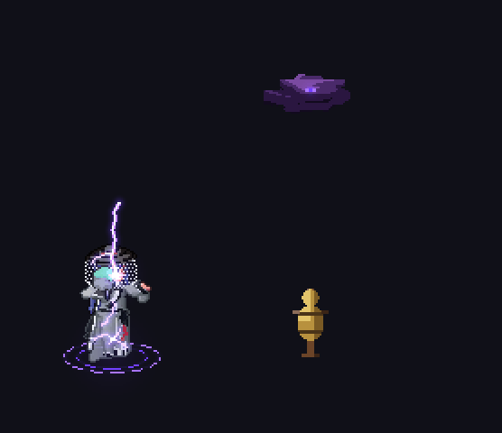
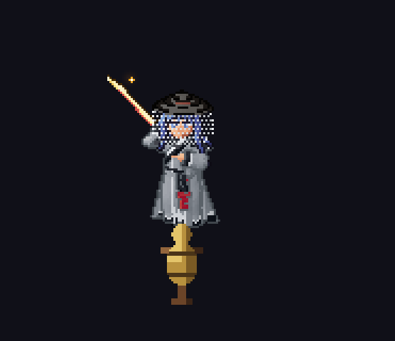

# beanfx

Pixel-art effects drawn as code. Describe an effect, and the `/beanfx` skill for Claude Code draws it in Python
and exports a sprite sheet with JSON that any engine plays.

<p>
  
  
</p>

**[Live demo and gallery](https://beanfx.vhbien000.workers.dev/)** · used in [Nine Heavens](https://play.nineheavens.online/)

## Install

```
/plugin marketplace add baenv/beanfx
/plugin install beanfx@beanfx
```

Needs Python 3.10+. The first run sets up `.venv/` (numpy, pillow) in your project.

## Use

```
/beanfx a fire burst, 64x64, side view, one-shot, strong glow
/beanfx path/to/reference.png make this a looping aura
```

The skill asks about anything the prompt leaves open, then writes the effect to `drafts/<name>/`:

- `<name>.py`: the effect as code; edit it and run it again
- `out/sheets/<name>.png` and `.json`: the sprite sheet and its JSON, the files a game loads
- `out/<name>.html`: a preview page that opens with a double click

Two game characters ship with the plugin (a sword caster and a staff caster, side and top-down), so an effect can
be drawn on a real sprite: pick "Game character" when the skill asks about a caster.

## Play it in a game

```js
import { loadFx, createFx } from "./beanfx.js";   // runtime/beanfx.js in the skill
const fx = createFx(await loadFx("fx/fire_burst.json"), { x: 160, y: 140 });
// each frame: fx.update(dt); fx.draw(ctx);
```

Phaser reads the JSON with `load.aseprite`. More:
[the JSON fields](docs/output-json.md) · [engines and porting](plugins/beanfx/skills/beanfx/porting.md)

## More

[Contributing](CONTRIBUTING.md) · [Changelog](CHANGELOG.md) · MIT, see `LICENSE`

The light layer learns from [pixelfx](https://github.com/patch-gg/pixelfx) (MIT, Patch); beanfx reimplements it in
Python and ships no pixelfx code.
