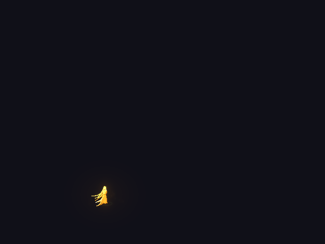
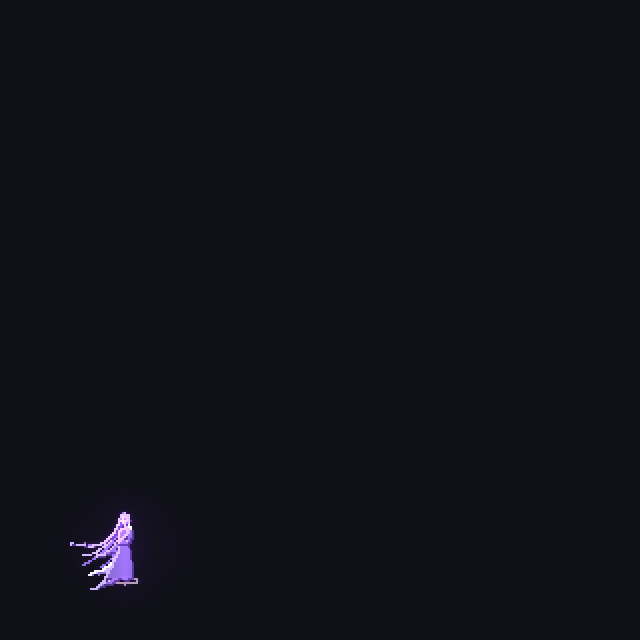
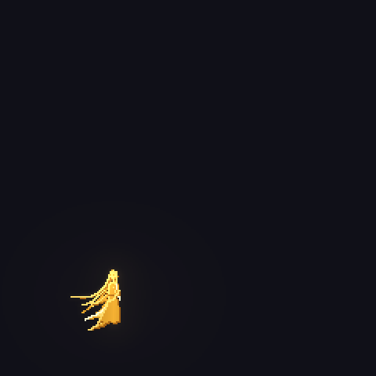

# beanfx

Pixel-art effects drawn as code. Each effect is a Python module: the base is shade maps of palette indices, and
the light (glow) is a separate additive layer. A run writes a sprite sheet, a JSON file (frame size, count, fps,
pivot, loop, states, in the Aseprite JSON layout that Phaser, Godot and Unity tools read) and preview gifs.
`plugins/beanfx/skills/beanfx/porting.md` shows how to import it into each engine or port the draw code, and
`runtime/beanfx.js` in the skill plays it in a browser game with no engine ([live demo](https://baenv.github.io/beanfx/)).

The `/beanfx` skill (`plugins/beanfx/skills/beanfx/SKILL.md`) drives the work: it asks about the knobs the prompt leaves
open, researches the subject, draws the effect and checks every frame for edge clipping and empty cells.

beanfx and [pixelfx](https://github.com/patch-gg/pixelfx) share the idea of effects as code with a separate light
buffer. pixelfx is a library of 244 small, ready effects written in JavaScript that draw live in the game. beanfx
draws one effect to order from your brief (size, palette, view, style, states, directions), often a large
multi-second skill, and ships it as sheets that any engine plays.

Work in progress: `/char` for characters and `/scene` for scenes. They stay local until they are ready.

## Results

The previews below play at half the frame rate to keep the files small. The sheets keep every frame.

### Ten Thousand Swords

A golden caster with a giant avatar behind rises inside a ring of swords, gathers them into a tilted turning
wheel, points, and the wheel pours a slanted rain of swords onto the field.

640x480, 165 frames at 30 fps, one-shot, glow strong. States: charge, appear_rise, gather, point, rain, dissolve.



### Great Wild Sky-Prison Finger

A storm swirls, its eye tears open, and a giant stone finger carved with runes slides out of the void and slams
the ground. The ground breaks into heaved slabs inside a rune ring, then the finger crumbles and pulls back, the
rift shuts and the clouds thin. A small violet-silver caster flies up first and points down.

320x320 (preview at 2x), 195 frames at 30 fps, one-shot, glow strong. States: fly, gather, tear, descend, prison,
fade.



### Wrathful Fire Lotus

21 heavenly flames ignite round a golden caster's waist, spiral into a 21-petal fire lotus, squeeze white-hot,
and are hurled down to bloom and burst on the ground.

240x240 (preview at 2x), 120 frames at 24 fps, one-shot, glow strong. States: summon, fuse, squeeze, hurl, fade.



## Install as a Claude Code plugin

```
/plugin marketplace add baenv/beanfx
/plugin install beanfx@beanfx
```

Then run `/beanfx <description | image>` in any project. The first run creates `.venv/` (numpy, pillow) and
`kit/` in that project and writes each effect to `drafts/<name>/`.

## Use in a browser game

```js
import { loadFx, createFx } from "./beanfx.js";        // plugins/beanfx/skills/beanfx/runtime/beanfx.js
const fx = createFx(await loadFx("fx/meteor_rite.json"), { x: 120, y: 250, onHit: (h) => console.log(h.react) });
// each frame: fx.update(dt); fx.draw(ctx); drop it when fx.done
```

It plays the colour sheet with the light added on top, states, mirror, heading rows, pages, and the hit-stop and
screen shake from the JSON. `docs/index.html` is the demo page.

## Layout

- `plugins/beanfx/`: the plugin; `.claude-plugin/marketplace.json` lists it.
- `kit/`: the drawing kit (`fxkit.py`, `fxlib.py`, `light.py`, `pfx.py`, `caster.py`, `target.py`, `ref.py`,
  `facing.py`, `derive.py`, `export.py`). Its source of truth is `plugins/beanfx/skills/beanfx/kit/`; `setup.sh`
  copies it here.
- `drafts/<name>/`: example effects, one each, `<name>.py` plus a generated `out/`.
- `docs/media/`: the README previews.

## Run

Needs Python 3.10+ (numpy and pillow go into `.venv/`).

```
bash plugins/beanfx/skills/beanfx/setup.sh               # .venv with numpy and pillow, kit/
cd drafts/<name> && ../../.venv/bin/python <name>.py      # writes out/, exits 1 if a cell touches its edge
```

Reuse of a pixelfx effect and the pixelfx benchmark need node 18+: `setup.sh --pixelfx` clones
https://github.com/patch-gg/pixelfx into `pixelfx/`. Drawing an effect needs only Python.

## Tests

```
S=plugins/beanfx/skills/beanfx
python3 $S/tests/test_gate.py
for t in facing derive export ref light; do .venv/bin/python $S/tests/test_$t.py; done
claude plugin validate plugins/beanfx && claude plugin validate .
```

## Credits

The light layer and the reuse path learn from [pixelfx](https://github.com/patch-gg/pixelfx) (MIT, Patch). beanfx
reimplements them in Python and ships no pixelfx code.

## License

MIT, see `LICENSE`.
